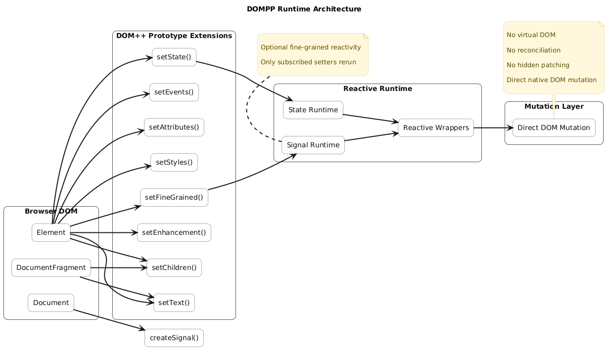
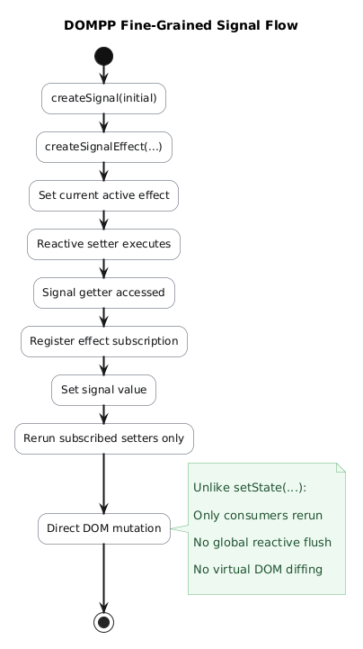
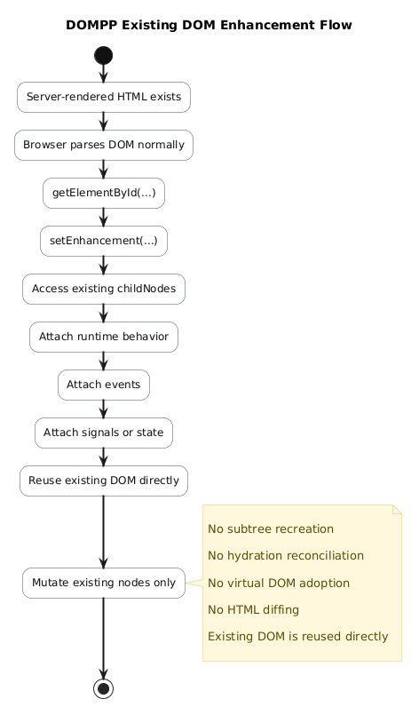

# DOMPP (DOM++)

DOMPP (DOM plus plus) is a lightweight native DOM enhancement library focused on deterministic mutation, chainable APIs, optional reactivity, and JSX-compatible builders.

The name "DOM++" is inspired by C++ naming style:

> DOM extended with small, explicit, chainable methods.

DOMPP does not use a virtual DOM. It does not wrap elements in custom objects and does not require a compiler. It extends native DOM APIs with ergonomic setters while preserving direct access to the browser platform.

## Install

```bash
npm install @dimpandu/domplusplus
```

## Quick Start

```js
import { createDOMPP } from "@dimpandu/domplusplus";

createDOMPP(); // Node/tests; in browsers the default entry also installs globals

const card = document
  .createElement("div")
  .setStyles({ padding: "20px", background: "black", color: "white" })
  .setChildren(
    document.createElement("h1").setText("Hello DOM++"),
    document.createElement("button").setText("Click Me").setEvents({
      click() {
        alert("DOM++");
      },
    })
  );

document.body.append(card);
```

## Element and Component Builders

DOMPP includes `elementBuilder` and `componentBuilder` for descriptor-based construction and reconciliation (JSX-compatible via a custom pragma/factory).

### Counter with `componentBuilder` rerender

```jsx
/** @jsx elementBuilder */
import { elementBuilder, componentBuilder } from "@dimpandu/domplusplus/builders";

let count = 0;

const counter = componentBuilder((rerender) => (
  <section className="card">
    <p>Count: {count}</p>
    <button
      type="button"
      onClick={() => rerender(() => { count += 1; })}
    >
      Increment
    </button>
  </section>
));

elementBuilder(document.getElementById("app"), null, counter.render());
```

### MVVM-style view with `componentBuilder`

```jsx
/** @jsx elementBuilder */
import { elementBuilder, componentBuilder } from "@dimpandu/domplusplus/builders";

function createCounterModel(initialCount = 0) {
  let count = initialCount;
  return {
    get count() { return count; },
    setCount(value) { count = value; },
  };
}

function createCounterViewModel(model) {
  const listeners = new Set();
  return {
    get count() { return model.count; },
    increment() {
      model.setCount(model.count + 1);
      listeners.forEach((listener) => listener(this));
    },
    addListener(listener) {
      listeners.add(listener);
      return () => listeners.delete(listener);
    },
  };
}

function CounterView() {
  const model = createCounterModel();
  const viewModel = createCounterViewModel(model);
  const view = componentBuilder(() => (
    <section className="card">
      <p>Count: {viewModel.count}</p>
      <button type="button" onClick={() => viewModel.increment()}>
        Increment through ViewModel
      </button>
    </section>
  ));
  viewModel.addListener(() => view.rerender());
  return view.render();
}

elementBuilder(document.getElementById("app"), null, <CounterView />);
```

Builder entry points:
- Default package: `@dimpandu/domplusplus` (installs DOMPP APIs; exposes `createDOMPP`).
- Builders: `@dimpandu/domplusplus/builders`
- Builders only (no prototype setter/reactive wrapper installation): `@dimpandu/domplusplus/builders-minimal`

## Features

### Runtime Architecture

DOMPP extends native DOM APIs with chainable mutation setters and optional reactive runtimes. Unlike virtual DOM frameworks, DOMPP performs direct deterministic DOM mutation.



### Chainable DOM Setters

* `setText(...)`
* `setChildren(...)`
* `setStyles(...)`
* `setAttributes(...)`
* `setEvents(...)`
* `setState(...)`
* `setEnhancement(...)`
* `setFineGrained(...)`

### Stateful Reactive Runtime

```js
const counter = document
  .createElement("button")
  .setState({ count: 0 })
  .setText(({ state }) => `Count: ${state.count}`)
  .setEvents(({ state, setState }) => ({
    click() {
      setState({ count: state.count + 1 });
    },
  }));
```

### Fine-Grained Signals

```js
const [count, setCount] = document.createSignal(0);

const title = document
  .createElement("h1")
  .setFineGrained()
  .setText(() => count());
```



### Existing DOM Enhancement

```js
document.getElementById("counter-app").setEnhancement(({ childNodes }) => {
  childNodes[1].setEvents({
    click() {
      childNodes[0].setText("1");
    },
  });
});
```



## JSX Integration

DOMPP works with JSX via a custom factory function. Configure your bundler or use Babel Standalone with the `/** @jsx d */` pragma (or use `elementBuilder` as the pragma for builder-based JSX).

```js
/** @jsx d */
function d(tag, props, ...children) {
  const svgTags = new Set([
    "svg", "circle", "path", "rect", "line", "polyline", "polygon", "ellipse",
    "g", "defs", "use", "symbol", "text", "tspan", "image", "foreignObject",
  ]);

  let node;
  if (tag === "fragment" || tag === "Fragment") {
    node = document.createDocumentFragment();
  } else if (svgTags.has(tag)) {
    node = document.createElementNS("http://www.w3.org/2000/svg", tag);
  } else {
    node = document.createElement(tag);
  }

  if (props) {
    const { style, className, class: classAttr, on, ...attrs } = props;
    if (className || classAttr) node.setAttributes({ class: className || classAttr });
    if (style) node.setStyles(style);
    if (on) node.setEvents(on);
    if (Object.keys(attrs).length) node.setAttributes(attrs);
  }
  if (children.length) node.setChildren(...children.flat());
  return node;
}
```

See `examples/21-jsx-integration/` for a live JSX demo and `examples/22-element-builder/` onward for builder examples.

## Local Development

Clone the repository and run the dev server:

```bash
git clone https://github.com/dimaspandu/dompp.git
cd dompp
npm install
npm run dev
```

Open `http://localhost:5173`. Examples cover basic setters, mutation consistency, children vs childNodes, reactive state, signals, enhancement, JSX, and builders.

## Testing

```bash
npm test
```

## Design Principles

* Explicit over magical behavior
* Native platform first
* No virtual DOM
* No hidden reconciliation
* No compiler required
* Minimal runtime surface area
* Predictable mutation flow
* Optional reactivity

## Status

DOMPP is experimental and under active iteration. Breaking changes may occur while APIs and runtime architecture continue evolving.

## Contributing

Contributions are welcome. Please read [CONTRIBUTING.md](./CONTRIBUTING.md) before submitting large architectural changes.

## Live Documentation

https://dompp.digital/

## License

MIT License. Copyright (c) Dimas Pandu Pratama.