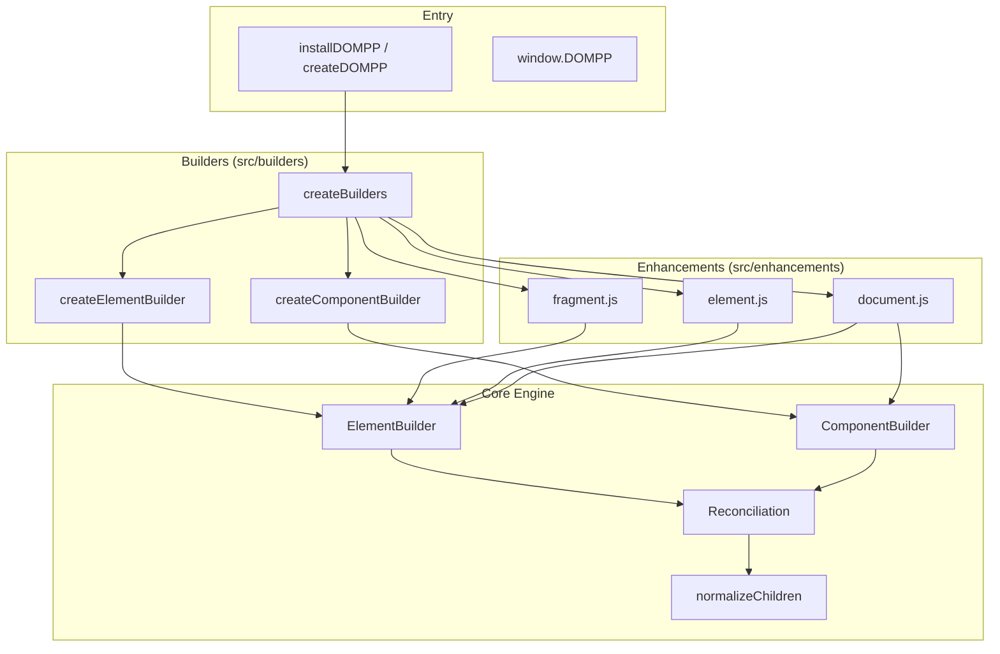

# DOM++ Architecture (High Level)

## Layers

- **Entry**: `installDOMPP(doc)` installs builders and enhancements onto a document; browser entry auto-installs `window.DOMPP`.
- **Builders**: pure factories (`createElementBuilder`, `createComponentBuilder`, `createBuilders`) with no global dependency.
- **Enhancements**: patch `Document`, `Element`, and `DocumentFragment` prototypes to delegate to builders.
- **Core Engine**: `ElementBuilder` (virtual descriptor + reconciliation), `ComponentBuilder` (render/rerender boundary).

## Key Invariants

- DOM nodes are real browser nodes; no virtual DOM wrapper.
- `ElementBuilder` holds a `struct` descriptor and a live `node`.
- Component render returns the rendered result directly (element or flat array) with a non-enumerable `.rerender`.
- Fragments and array-returning components produce flat child arrays (per-slot reconciliation).
