# DOMPP Architecture

This directory contains architectural diagrams and runtime flow documentation for DOMPP.

The goal of these diagrams is to explain:

* how DOMPP mutates the DOM
* how reactivity works internally
* how signals propagate updates
* how enhancement differs from hydration
* how builders perform local reconciliation
* how DOMPP positions itself architecturally

DOMPP intentionally prioritizes:

* native DOM mental models
* deterministic mutation
* minimal abstraction
* explicit runtime behavior

---

# Runtime Architecture

DOMPP extends native DOM APIs with small chainable setters and optional reactive runtimes.

Unlike virtual DOM frameworks, DOMPP performs direct deterministic DOM mutation.

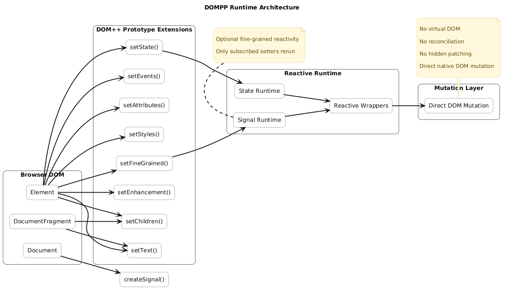

Key ideas:

* direct DOM mutation
* no virtual DOM
* no reconciliation engine
* optional runtime layers
* native DOM remains primary

---

# Stateful Runtime

DOMPP includes a lightweight stateful runtime using `setState(...)`.

Reactive setter callbacks rerun after state changes.

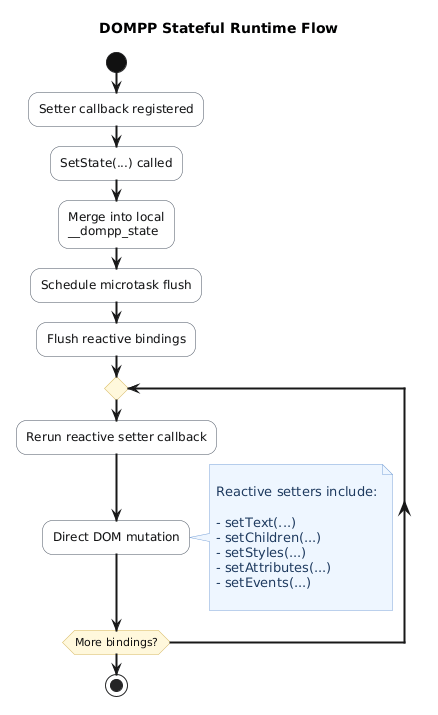

Flow:

1. local state mutation
2. microtask scheduling
3. binding flush
4. setter rerun
5. direct DOM mutation

This model is intentionally simple and explicit.

---

# Fine-Grained Signals

DOMPP also supports optional fine-grained signal reactivity.

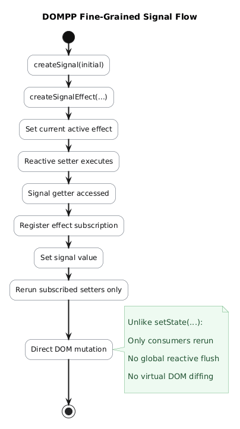

Unlike the stateful runtime:

* only signal consumers rerun
* no global reactive flush occurs
* reruns remain granular and explicit

Signals are fully opt-in through:

```js
.setFineGrained()
```

DOMPP still supports the original stateful runtime model.

---

# Existing DOM Enhancement

DOMPP supports enhancement-style runtime attachment for server-rendered or static HTML.

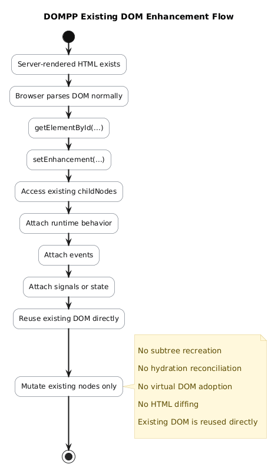

This allows:

* existing DOM reuse
* direct node adoption
* hydration-like flows
* progressive enhancement

Without:

* virtual DOM hydration
* subtree recreation
* reconciliation passes
* HTML diffing

The existing DOM itself becomes the runtime target.

---

# children vs childNodes

DOMPP intentionally exposes both:

* `children`
* `childNodes`

because enhancement and DOM reuse often require exact structural access.

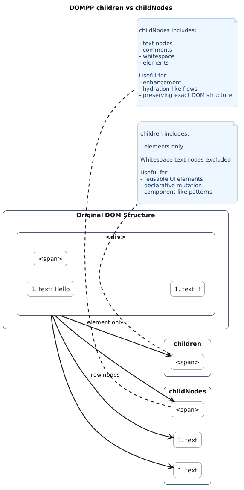

## children

Includes:

* element nodes only

Excludes:

* text nodes
* whitespace nodes
* comments

Useful for:

* reusable UI structures
* declarative element mutation
* component-like patterns

---

## childNodes

Includes:

* text nodes
* whitespace nodes
* comments
* elements

Useful for:

* enhancement
* hydration-like assimilation
* preserving exact DOM structure

---

# Runtime Positioning

DOMPP occupies a different runtime philosophy compared to many modern UI systems.

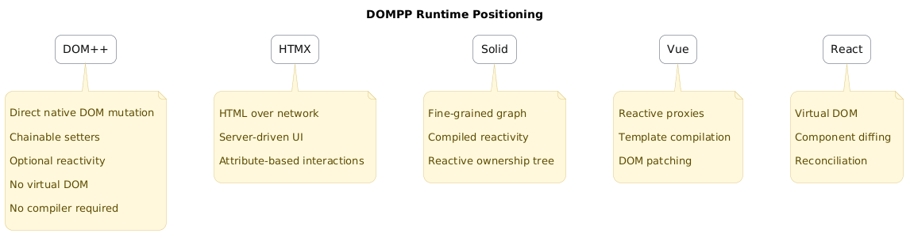

DOMPP focuses on:

* native DOM mutation
* optional reactivity
* deterministic updates
* minimal runtime orchestration

Rather than:

* virtual DOM ownership
* hidden reconciliation
* template compilation
* framework abstraction layers

---

# DOMPP Vision

DOMPP also explores the idea of a lightweight DOM mutation capability layer that higher-level runtimes could potentially build upon.

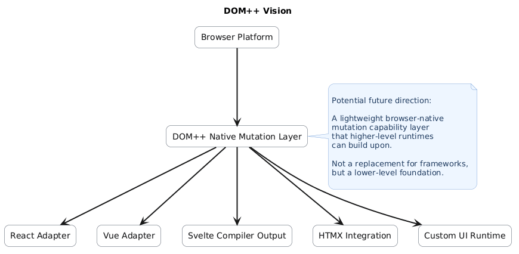

This is not intended as a replacement for frameworks.

Instead, DOMPP explores whether:

* native DOM mutation ergonomics
* optional reactivity
* enhancement-based runtime attachment

could function as lower-level browser-native UI primitives.

Potential future integrations could include:

* JSX transforms
* template compilers
* SSR enhancement systems
* framework adapters
* custom runtime layers

while preserving direct DOM access underneath.

---

# Element & Component Builders (1.2.0)

DOMPP 1.2.0 adds descriptor-based builders for direct, local DOM reconciliation.

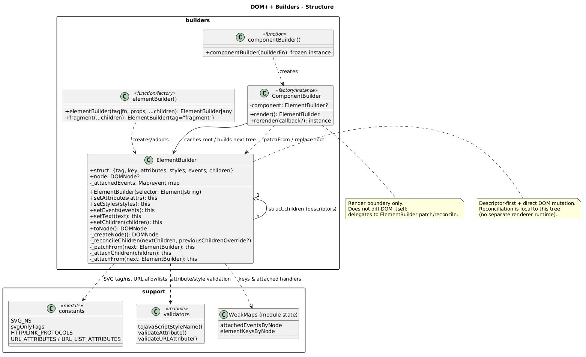
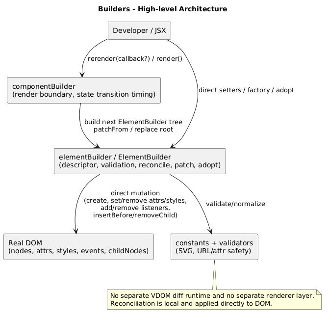
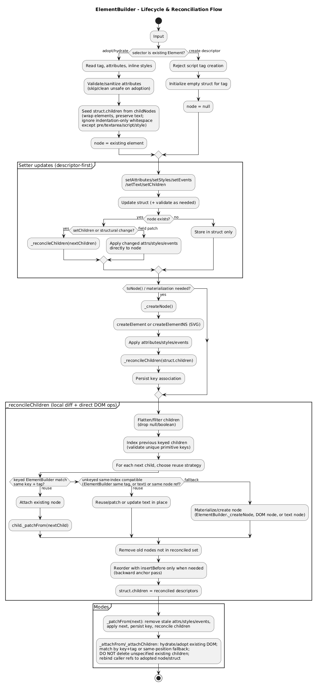
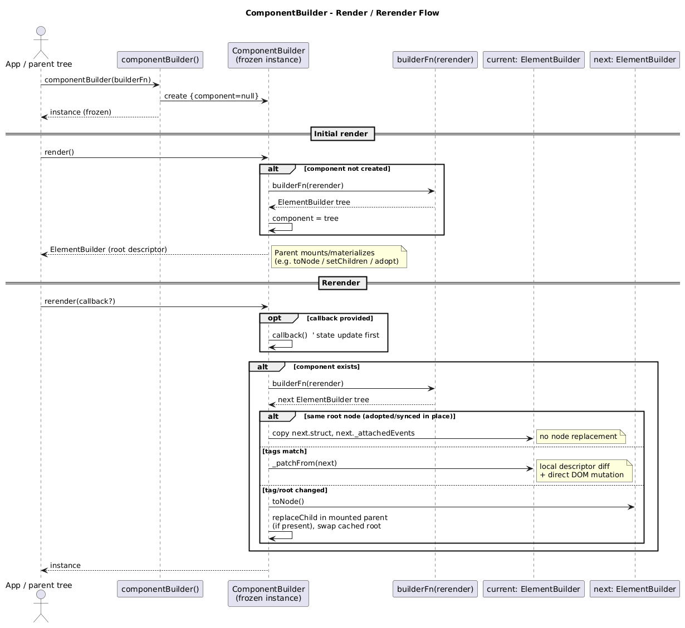

Key ideas:

* descriptor-first state (struct) with optional direct DOM mutation
* local reconciliation/patching (keyed/unkeyed reuse, attach/adopt semantics)
* no separate virtual DOM diff engine and no separate renderer runtime
* componentBuilder as a render boundary; ElementBuilder handles DOM mutation details
* `elementBuilder.reset()` clears virtual struct and live DOM for clean slate patterns

API summary:

* `elementBuilder(tag, props, ...children)` — creates or adopts an element with descriptor
* `elementBuilder(node, props, ...children)` — adopts existing DOM node
* `ElementBuilder.prototype.reset()` — clears styles, attributes, children, events on struct and live node
* `componentBuilder((rerender) => tree)` — stateful render boundary with `render()` and `rerender(callback)`
* `componentBuilder._patchFrom()` — full attribute/style/children replacement on rerender

---

# Example Coverage

The `examples/` directory contains 35 progressive examples demonstrating all features:

**Foundations (01-08)**
* 01 Basic Text — `setText()`
* 02 Basic Styles — `setStyles()`
* 03 Basic Attributes — `setAttributes()`
* 04 Basic Children — `setChildren()`
* 05 Basic Events — `setEvents()`
* 06 Mutation Consistency — unified setter patterns
* 07 Children vs ChildNodes — structural vs raw node access
* 08 Fragment Support — DocumentFragment usage

**Reactive Runtime (09-20)**
* 09 Reactive Counter — local `setState()` with reactive text/styles/attributes
* 10 Reactive Children — dynamic child trees from state
* 11 Reusable Stateful Elements — element reuse across parents
* 12 Cross-Element State — coordinated mutations via `setState()`
* 13 Existing DOM Enhancement — `setEnhancement()` progressive enhancement
* 14 Fine-Grained Signals — `createSignal()`, `setFineGrained()`
* 15 Enhancement + Signals — reactive progressive enhancement
* 16 State Equality Behavior — reference vs value equality
* 17 Nested Stateful Elements — independent nested state
* 18 Keyed List Behavior — stable keys for list reconciliation
* 19 DOM Identity Preservation — focus/selection preservation
* 20 Reactive Feed — prepend/append feed patterns

**JSX & Builders (21-35)**
* 21 JSX Integration — Babel Standalone, custom factory, all reactive features
* 22 Element Builder — descriptor API, direct setters, JSX factory
* 23 Component Builder — `componentBuilder`, `render()`, `rerender(callback)`
* 24 MVVM Component Builder — Model/ViewModel/View layering
* 25 Conditional Rendering — `null` children, dynamic presence
* 26 Keyed List — reconciliation with stable keys
* 27 Fragments and Arrays — fragment boundaries, array components
* 28 Server DOM Adoption — adoption of server-rendered HTML
* 29 Reactive Server Messenger — component over adopted server root
* 30 BigView Independent Updates — stable root, direct mutations, coordinated rerenders
* 31 MVVM BigView Sections — topic-based selective rerenders
* 32 Security Boundary — attribute validation, text rendering for untrusted content
* 33 elementBuilder Outlet with reset() — clean slate route transitions
* 34 componentBuilder Outlet with rerender() — `_patchFrom` route transitions
* 35 Local Stateful Inside Stateless (ViewModel) — local `componentBuilder` subtree rerendered by ViewModel notifications within a stateless container

---

# Notes

These diagrams are conceptual runtime documentation.

They are intended to help contributors and readers understand:

* architectural direction
* runtime flow
* internal design philosophy
* reactive behavior
* mutation strategy

rather than serving as strict implementation specifications.