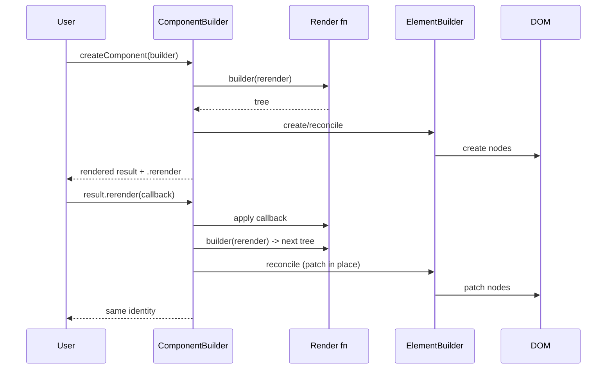
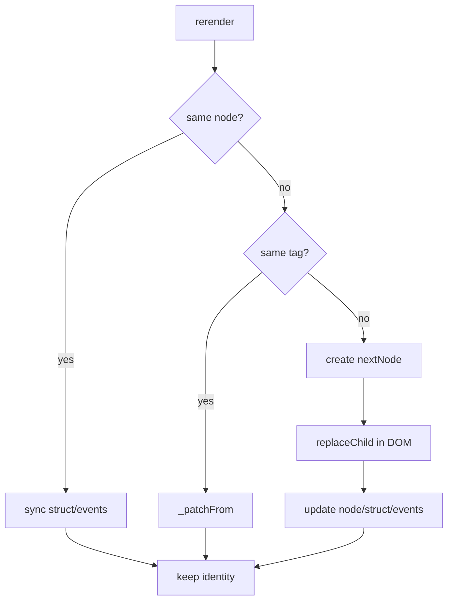
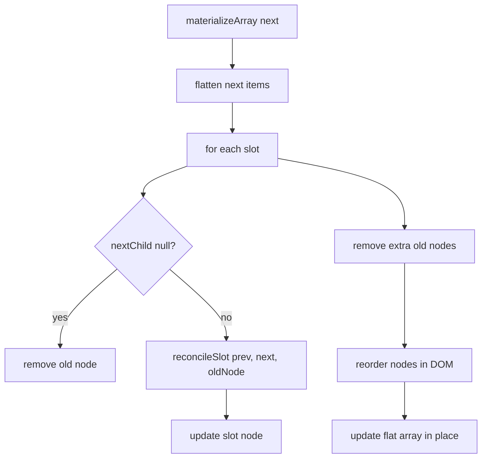

# Component Rerender Flow

## Render and Rerender

## Element Root Tag Change

When a component's root tag changes between renders, identity is preserved by replacing the node but keeping the same `ElementBuilder` instance.

## Array Component Reconciliation

