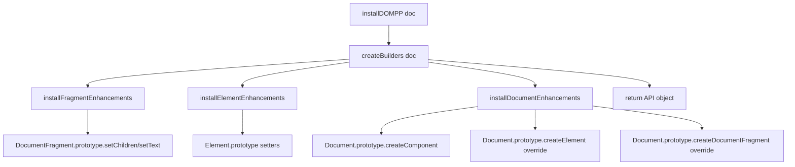
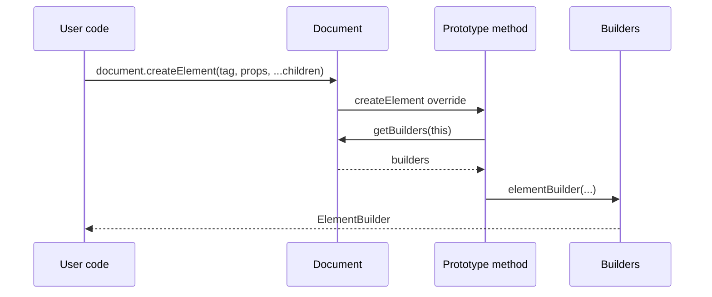
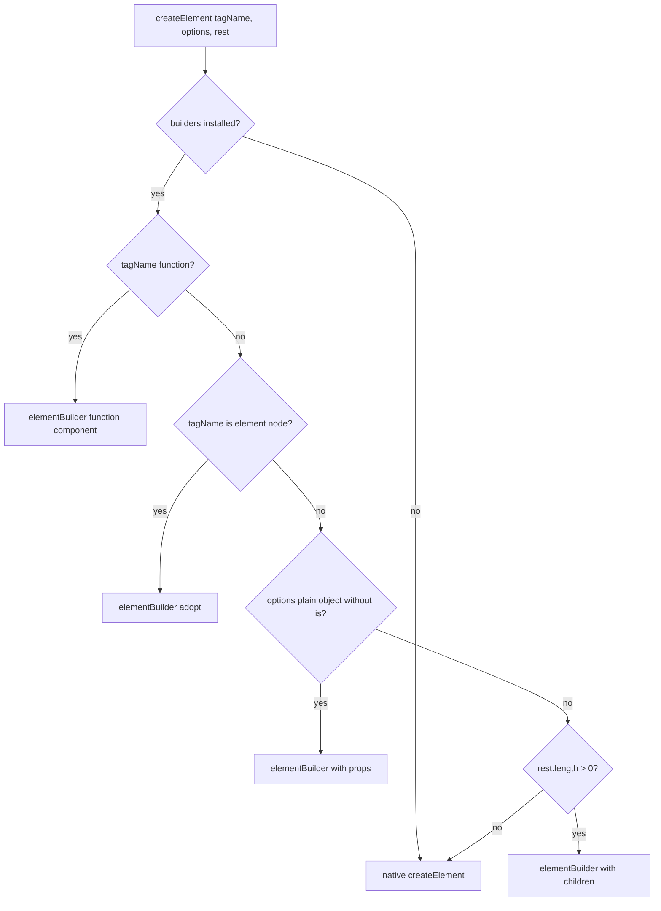
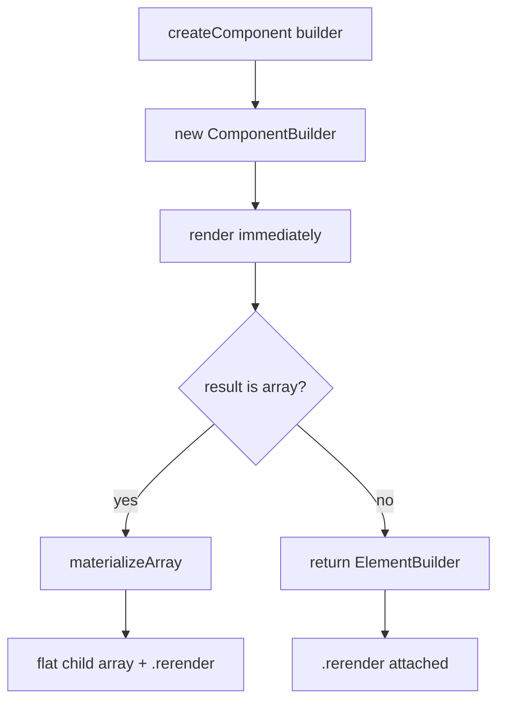

# Enhancement Flow (High Level)

## Installation

## Per-Document Builder Resolution

Enhancements store builders on `doc.__domppBuilders`. Prototype methods resolve builders from `target.ownerDocument` (or the document itself), so the same prototypes work across documents.

## createElement Routing

## createComponent

`document.createComponent(builder)` returns a rendered `ElementBuilder` (or flat array) extended with `.rerender(callback?)`.

