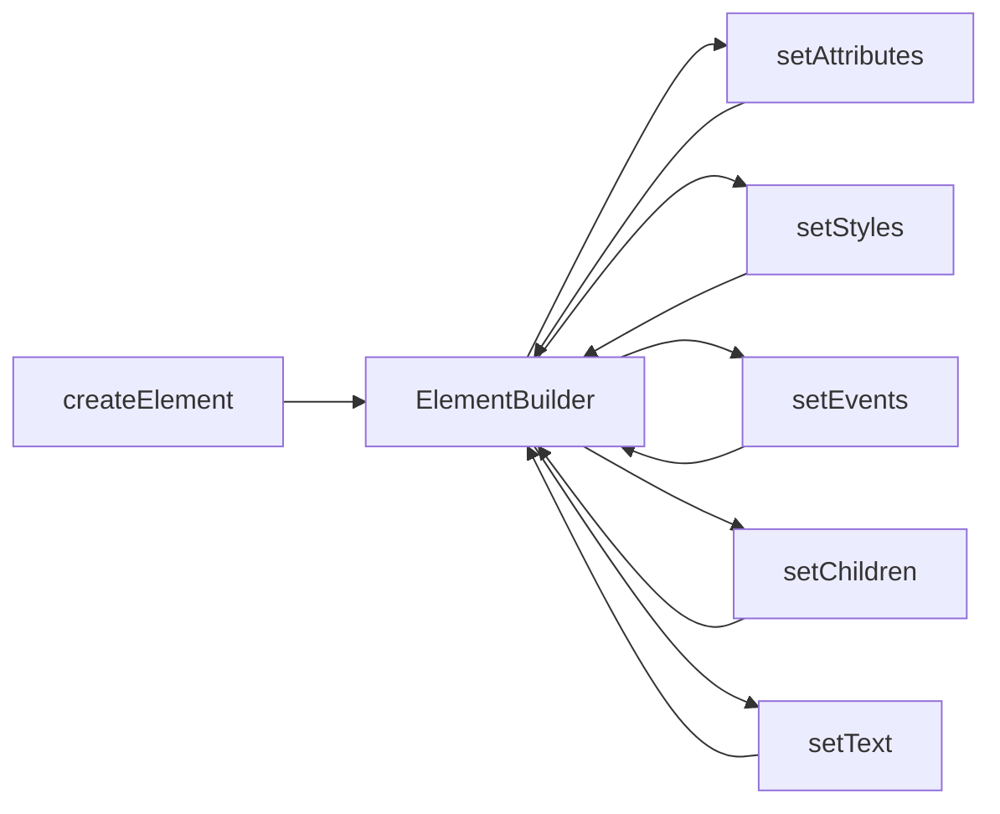
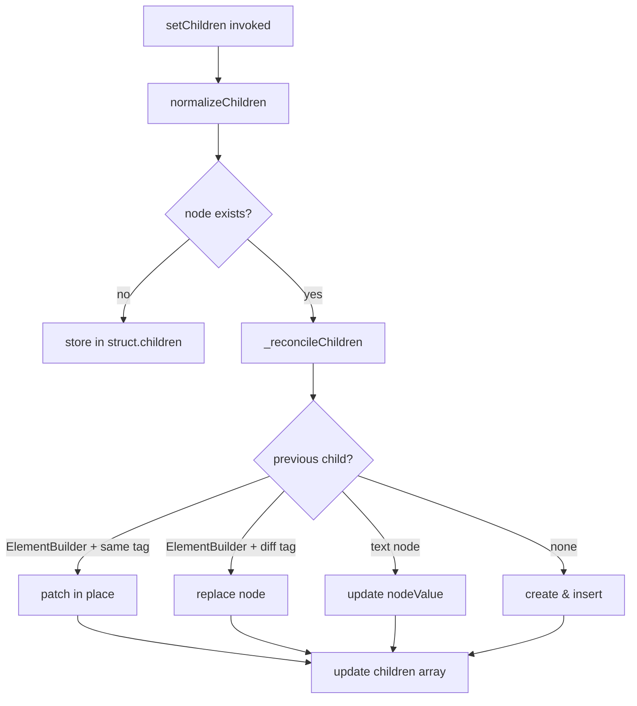
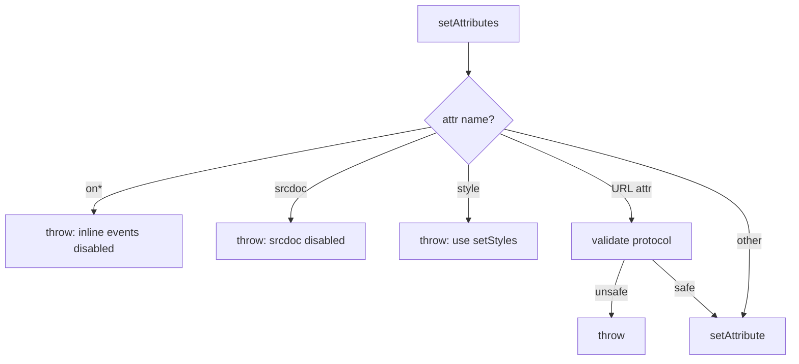

# Setters Flow

## Chainable Setters

All setters return the same `ElementBuilder` for fluent composition.

## setChildren Reconciliation

## setText

`setText(text)` is `setChildren([text])` — normalizes to a single text child and reconciles.

## Security Guards (setAttributes)

